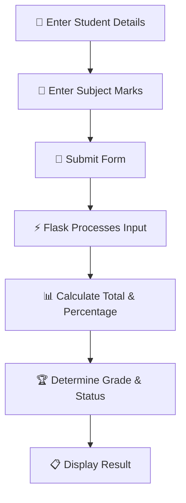

<div align="center">

# 🎓 EduResult Pro

### Student Result Dashboard

**A modern, web-based student result management application built with Python and Flask.**

Calculate marks, percentages, grades, and academic results through a clean and intuitive interface.

<br>


</div>

---

## ✨ Overview

**EduResult Pro** is a lightweight web application designed to simplify student result calculation. It allows users to enter student details and subject marks, then automatically generates academic results with total marks, percentage, grade, and pass/fail status.

The application combines Python-based backend processing with a modern, responsive frontend to provide a smooth and user-friendly experience.

---

## 🚀 Features

| Feature | Description |
|---|---|
| 👤 Student Details | Enter student name and roll number |
| 📝 Marks Entry | Input marks for five subjects |
| ➕ Total Calculation | Automatically calculates total marks |
| 📊 Percentage | Calculates the overall percentage |
| 🏆 Grade System | Assigns grades based on performance |
| ✅ Result Status | Determines Pass or Fail |
| 🎨 Modern UI | Attractive, clean, and visually appealing interface |
| 📱 Responsive Design | Designed to adapt to different screen sizes |

---

## 🛠️ Tech Stack

| Technology | Purpose |
|---|---|
| 🐍 Python | Backend programming and calculation logic |
| ⚡ Flask | Web framework and server-side processing |
| 🌐 HTML5 | Webpage structure |
| 🎨 CSS3 | Styling and user interface design |
| 📄 Jinja2 | Dynamic HTML rendering |
| 💻 VS Code | Development environment |
| 🔗 Git & GitHub | Version control and project hosting |

---

## 📂 Project Structure

```text
EduResultPro/
│
├── app.py                  # Flask application & result logic
├── requirements.txt         # Project dependencies
├── README.md               # Project documentation
├── .gitignore              # Ignored files configuration
│
├── templates/
│   └── index.html          # Main webpage
│
└── static/
    └── style.css           # UI styling
```

---

## ⚙️ Installation & Setup

Follow these steps to run EduResult Pro locally.

### 1️⃣ Clone the repository

```bash
git clone https://github.com/vaishnavipandurangbelote/EduResultPro.git
```

### 2️⃣ Navigate to the project folder

```bash
cd EduResultPro
```

### 3️⃣ Create a virtual environment

```bash
python -m venv .venv
```

### 4️⃣ Activate the virtual environment

**Windows PowerShell:**

```powershell
.\.venv\Scripts\Activate.ps1
```

### 5️⃣ Install dependencies

```bash
pip install -r requirements.txt
```

### 6️⃣ Start the Flask server

```bash
python app.py
```

### 7️⃣ Open the application

Visit the following address in your browser:

🌐 **http://127.0.0.1:5000**

---

## 🖥️ Application Workflow



---

## 🎯 Project Objective

The objective of this project is to design, develop, and experimentally test a domain-specific mini web server using Python and Flask while demonstrating web application development, form handling, backend processing, and dynamic result rendering.

---

## 🎓 Academic Information

- **Project:** EduResult Pro – Student Result Dashboard
- **Domain:** Web Application Development
- **Purpose:** College Academic Activity
- **Course:** B.Sc. Information Technology

---

## 👩‍💻 Developer

<div align="center">

### Vaishnavi Pandurang Belote

_B.Sc. Information Technology Student_

</div>

---

<div align="center">

⭐ **If you find this project interesting, consider giving it a star!**

_Made with 💙 using Python & Flask_

</div>
